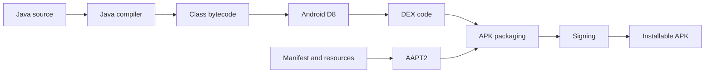

# Build Still

## Requirements

| Tool | Project setting |
| --- | --- |
| Java Development Kit | 17 or newer; JDK 21 is used in CI |
| Android SDK Platform | 36 |
| Android SDK Build Tools | 36.0.0 |
| Gradle | 8.13, downloaded by the included wrapper |
| Android Gradle Plugin | 8.13.2 |
| Supported phone | Android 8.0 / API 26 or newer |

Java source compatibility is set to 11. This is separate from the JDK version used to run Gradle. The app uses Android's platform APIs and has no application library dependencies.

The wrapper verifies the Gradle distribution against its pinned SHA-256 checksum. See the [Android Gradle Plugin compatibility table](https://developer.android.com/build/releases/agp-8-13-0-release-notes).

## Android Studio

1. Clone this repository and open its root folder in Android Studio.
2. In SDK Manager, install Platform 36 and Build Tools 36.0.0.
3. Select a Gradle JDK of 17 or newer in the IDE's Gradle settings. Android Studio's bundled JDK 21 is suitable.
4. Let Android Studio create `local.properties` with your SDK path and finish Gradle sync.
5. Select the `debug` build variant and generate an APK from the Build menu, or run the wrapper commands below.

`local.properties` belongs to your machine and is ignored by Git. You can use `ANDROID_HOME` to identify the SDK when building outside Android Studio.

## Windows / PowerShell

From the repository root:

```powershell
# Adjust this if your JDK is installed elsewhere.
$env:JAVA_HOME = 'C:\Program Files\Android\Android Studio\jbr'

.\scripts\test.ps1
.\gradlew.bat --no-daemon assembleDebug lintDebug
```

## Linux / macOS

From the repository root, with `JAVA_HOME` pointing to JDK 17+:

```bash
bash scripts/test.sh
./gradlew --no-daemon assembleDebug lintDebug
```

The debug APK is generated at `app/build/outputs/apk/debug/app-debug.apk`. These commands compile the project, run Android lint, and run the separate Android-independent policy suite. They do not exercise accessibility on a phone.

## Signed APKs and updates

Use Android Studio's **Generate Signed App Bundle or APK** wizard and choose **APK**. Keep the signing key and passwords outside the repository. A normal debug build has a different signing certificate from the APK checked into `releases/`, and cannot install over that signed build.

Future updates to the distributed Still APK need its original signing key. The key backup is held privately by the project owner. It is not included in this repository. Increase `versionCode` for an update and change `versionName` for the displayed version.

The repository does not automatically sign or publish releases. CI produces a debug APK for testing, clearly separate from the signed APK in `releases/`.

## How Java becomes an APK



Gradle coordinates those tools. The Java compiler creates `.class` files; [D8](https://developer.android.com/tools/d8) converts them into Android DEX code; [AAPT2](https://developer.android.com/tools/aapt2) compiles and links resources. Packaging combines them, and a signing key supplies the APK's update identity. See [Android app signing](https://developer.android.com/studio/publish/app-signing).
