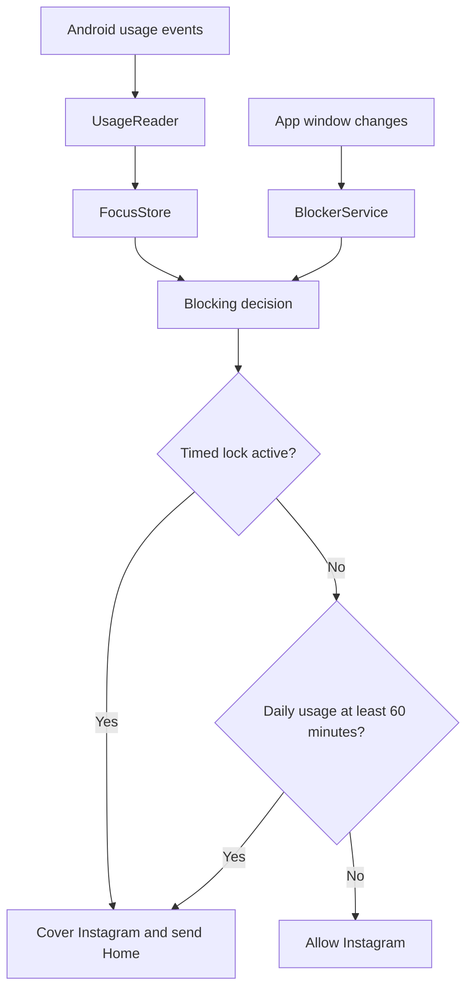

# How Still works

Still has two rules that apply to Instagram:

1. A fixed daily limit of 60 minutes of Instagram foreground usage.
2. An optional timed lock that starts immediately and lasts for a chosen duration.

Either rule can block the app. An expired timed lock cannot override an exhausted daily allowance. Other apps' screen time does not consume Instagram's allowance.

## Flow

Missing usage access, unavailable usage data, or a detected clock change also cause the daily rule to block while the accessibility service remains active. If the accessibility service itself is disabled, Still cannot enforce blocking.

## Components

| Class | Responsibility |
| --- | --- |
| `MainActivity` | Permission setup, daily usage display, and timed-lock controls, including the 24-hour preset |
| `Rules` | One-hour limit, countdown math, blocking policy, and usage-event reducer |
| `FocusStore` | Private settings, deadlines, daily usage high-water mark, and reset window |
| `UsageReader` | Read Android usage events and count Instagram foreground sessions |
| `BlockerService` | Watch app-window events, refresh usage, and enforce active rules |
| `Ui` | Shared colors, text, cards, and buttons |
| `TimerView` | Draw the countdown or remaining daily time |

The sources are in `app/src/main/java/app/still/focus/`.

## Instagram usage accounting

Android's [UsageStatsManager](https://developer.android.com/reference/android/app/usage/UsageStatsManager) supplies activity events after the user grants Usage access. Still handles resume, pause, stop, screen-off, and device-shutdown events. Sessions are clipped to the current daily window. A lookback captures a session that began before midnight.

Only `com.instagram.android` and `com.instagram.lite` contribute usage. Both share the same hour. Other app resumes close a tracked Instagram session. Duplicate resume events and pauses from an outgoing activity do not double-count or prematurely close a newly resumed Instagram activity.

The usage total includes Instagram use earlier in the day, even before Still was opened. A saved high-water mark keeps already-recorded usage from decreasing within a day. No event log is saved by Still.

The service checks rules every 500 ms. Usage reads run on a background executor, normally at least one second apart while Instagram is visible and ten seconds apart otherwise. Blocking follows Android's event delivery and the next completed check; it is not guaranteed at an exact millisecond. A foreground-generation check prevents an older async usage result from overriding a newer app-window event.

## Blocking

The accessibility service observes app-window package names. When Instagram is detected and a rule blocks it, the service adds a touch-intercepting accessibility overlay and performs Android's Home action. The overlay explains the lock and offers a return-to-home button. If the overlay cannot be shown, the service still attempts Home and displays a toast.

The service requests neither screen-content retrieval nor gesture capability. It does not suspend the Instagram package or take control of Android Settings. Calls and unrelated apps are outside the blocking rules.

## Daily reset and clock behavior

The initial daily window runs from local midnight to the next local midnight. At the next reset, saved daily usage clears and the next window is created. A time-zone change does not immediately shorten an already-saved window.

The saved clock advances using Android's monotonic elapsed time within a boot. Timed-lock deadlines use that clock rather than accepting a changed wall clock immediately. A wall-clock difference greater than two minutes marks the daily window as clock-changed and locks daily access. Restore the system clock to its correct time; an already-marked window remains locked until its reset.

After reboot, the clock uses the later of the saved trusted time and the current system time. Deliberately changing the clock before reboot can bypass this protection. These are local safeguards, not an external trusted-time service.

## Limits

The user can disable Accessibility, force-stop Still, clear its app data, or uninstall it; those actions stop enforcement, and uninstalling or clearing data removes the saved lock. Android restricts uninstall blocking to device/profile owners, a managed-device configuration that this APK does not request. Browser Instagram, renamed/cloned packages, other Android profiles, and manufacturer battery restrictions are also outside the guarantee. See [Android's DevicePolicyManager documentation](https://developer.android.com/reference/android/app/admin/DevicePolicyManager).

The checked-in APK has compilation, policy-test, packaging, and signature checks. Device behavior has not been verified. Follow [the device checklist](DEVICE_TESTING.md) before relying on it.
